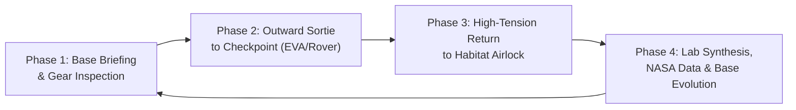

# SPEC.md — Master Product Requirements & System Architecture Specification

> **File Overview & Purpose:**  
> This document is the unified, authoritative technical specification for **Ares Cradle** (v3.2). It consolidates both the **Product Requirements (PRD)** and the **System Architecture (Architecture)** into a single cohesive reference. It defines the core game loop, pedagogical goals, 5 Sol milestones within the 80m exploration boundary, Three.js/R3F rendering pipeline, state management topology, and non-overlapping HUD layout standards.

---

# Part I: Product Requirements Document (PRD)

## 1. Executive Summary & Educational Vision

### 1.1 The Educational Problem
Traditional STEM space games typically fail in one of two extremes:
1. **Shallow Clickers:** Provide infinite resources with zero scientific friction, failing to teach authentic engineering principles.
2. **Dense Academic Simulators:** Overwhelm elementary and middle-school cadets with complex differential calculus and endless spreadsheets.

### 1.2 The Ares Cradle Solution
**Ares Cradle** is a browser-based, 3D tactile Mars outpost simulator. It simplifies outpost survival to a **2-Resource Engineering Trade-off** (Energy Allocation vs. Life Support) while preserving authentic physical constraints: **every decision incurs a physical cost**.



---

## 2. Target Persona & Experience Design

- **Primary Persona:** *Cadet Leo* (Ages 8–15). Visual learner, curious, motivated by real-time visual rewards, tactile controls, and clear cause-and-effect.
- **Secondary Persona:** *STEM Educator*. Needs an instant-launch, zero-login interactive demonstration that fits within a 15–20 minute classroom workshop.
- **Core Loop Philosophy:** The **4-Phase Sortie Cycle**:
  1. **Phase 1 (Habitat Briefing):** Review directive from Earth Command, check suit battery and O₂ buffer, depart through the airlock.
  2. **Phase 2 (Outward Sortie):** Travel to field checkpoints on foot or via Exploration Rover within the 80m boundary.
  3. **Phase 3 (High-Tension Return):** Monitor battery drain per meter, night freeze ($-60^\circ\text{C}$), and race back to the habitat airlock before life support depletion.
  4. **Phase 4 (Lab Synthesis & Base Evolution):** Deposit specimens into the console, study multi-tier NASA data cards, answer 1 intuitive STEM check, and observe immediate 3D visual upgrades to the dome and rover.

---

## 3. The 5 Sol Milestones (Strict 80m Exploration Sphere)

All checkpoints are placed within an 80-meter operational sphere around the Bio-Dome Habitat $[0, 0, 0]$:

| Sol | Title & POI | Coordinates & Range | Transit Mode | NASA Mission Reference | Survival Challenge & Engineering Trade-Off |
| :--- | :--- | :--- | :--- | :--- | :--- |
| **Sol 1** | *First Light: Solar Array* | `[-6.0, 0, 4.0]` (7.2m) | Rover, then foot EVA | **Opportunity Rover** (Photovoltaic Dust & RAT Tool) | The pre-deployed habitat is in safe mode; drive to the dusty solar mast, clear the panels, and bring the first outpost online. |
| **Sol 5** | *Red Wall: Crater Alpha* | `[18.0, 0, -30.0]` (35.0m) | Rover Recommended | **Spirit & Opportunity** (Hematite Blueberries) | Electrostatic dust devil approaches (-60% solar); harvest blueberries and race back before visibility drops. |
| **Sol 9** | *Frozen Water: North Glacier* | `[-25.0, 0, -50.0]` (55.9m) | Rover Required | **Phoenix Lander & MRO** (Permafrost Ice Trench) | Extreme polar cold ($-80^\circ\text{C}$); high heater power draw; extract ice cores and return to purify water in lab. |
| **Sol 12** | *Breath of Mars: MOXIE Tower* | `[35.0, 0, 18.0]` (39.3m) | Foot / Rover | **Perseverance Rover** (MOXIE CO₂-to-O₂ Electrolysis) | Hull seal Bravo breach causes pressure drop; retrieve catalyst from tower, patch dome with tape, stabilize O₂ > 19.5%. |
| **Sol 20** | *Green Shield: Mesa Peak* | `[-40.0, 0, 62.0]` (73.8m) | Rover High-Beam | **Curiosity RAD & ISS Veggie** (Ares-1 Touchdown) | Longest sortie over rough terrain; activate high-gain sky laser beacon on ridge to guide crewed transport. |

---

## 4. Visual Evolution: Dynamic 3D Upgrades

As Cadet Leo completes each Sol milestone, the Bio-Dome Habitat and Mars Rover physically upgrade:

### 4.1 Bio-Dome Habitat Evolution (`domeEvolutionLevel`: 1 to 5)
- **Level 1 (Sol 1):** Primary interior arc-lights illuminate; solar tracking motors spin.
- **Level 2 (Sol 5):** Orbiting moons (Phobos & Deimos) appear on the central 3D Mars hologram table.
- **Level 3 (Sol 9):** Luminescent blue water conduits circulate along the habitat perimeter ring.
- **Level 4 (Sol 12):** Second-story observation deck pressurizes; hydroponic microgreen trays glow bright green.
- **Level 5 (Sol 20):** Ground beacon fires a vertical cyan sky-laser column ($30\text{m}$ high) to guide Ares-1.

### 4.2 Mars Rover Visual Attachments (`roverUpgradeLevel`: 1 to 5)
- **Level 1 (Sol 1):** Standard Rocker-Bogie chassis with dual low-beam halogen lights.
- **Level 2 (Sol 5):** Front magnetic regolith scoop attached to forward bumper.
- **Level 3 (Sol 9):** Rear ultrasonic permafrost core drill mounted on flatbed.
- **Level 4 (Sol 12):** Auxiliary atmospheric battery buffer pods ($+25\text{ kWh}$) mounted on both chassis flanks.
- **Level 5 (Sol 20):** Gold Kapton thermal foil wrap and dual high-intensity beam projectors.

---

# Part II: System Architecture

## 5. Technical Stack & Architectural Layers

Ares Cradle utilizes a reactive, decoupled, web-first frontend architecture:

```
┌────────────────────────────────────────────────────────┐
│                   ARES CRADLE CLIENT                   │
├────────────────────────────────────────────────────────┤
│ 1. Tactical HUD Layer (TailwindCSS + Framer Motion)    │
│    - CockpitVisorHUD.tsx (Single flex top bar)         │
│    - MinimapRadar.tsx (25m / 50m / 80m Zoom Radar)     │
│    - HorizontalDatapadHUD.tsx (Telemetry & Lessons)    │
│    - FieldSpecimenToast.tsx (3s non-blocking toast)    │
├────────────────────────────────────────────────────────┤
│ 2. 3D WebGL Diorama Layer (Three.js + R3F + Drei)      │
│    - MarsTerrain.tsx (Low-poly crater landscape)       │
│    - HabitatDome.tsx & HabitatInterior.tsx             │
│    - MarsRover.tsx (Rocker-Bogie 6-wheel physics)      │
│    - SpaceSkybox.tsx (Orrery celestial bodies)         │
├────────────────────────────────────────────────────────┤
│ 3. State Management Layer (Zustand + LocalStorage)     │
│    - useOutpostStore.ts (Telemetry, power, rover)      │
│    - useStoryStore.ts (Sols, chapters, objectives)     │
├────────────────────────────────────────────────────────┤
│ 4. Procedural Audio Synthesizer (Native Web Audio API) │
│    - soundEngine.ts (Sub-bass hum, clicks, alarms)     │
├────────────────────────────────────────────────────────┤
│ 5. Data-Driven Content Engine (JSON Schemas)           │
│    - chapters.json, worldAnchors.json, capsules/*.json │
└────────────────────────────────────────────────────────┘
```

---

## 6. Zero-Overlap HUD Layout Geometry

To eliminate visual overlap across all 16:9 and ultrawide resolutions:

```
Top-Left (x: 12px)                                      Top-Right (x: 100% - 144px)   Top-Right (12px)
┌─────────────────────────────────────────────────────────────────────────────────┐   ┌────────────┐
│ [🚀 SOL 1/20] [☀️ 12:45] [🎯 Solar Array 7.2m] [🧪 0/3] | MISSION: Reach ... |   │   │  MINIMAP   │
│ (Left Cluster)             (Center Objective)            (Action Tray [R,E,G])  │   │   RADAR    │
└─────────────────────────────────────────────────────────────────────────────────┘   │  (w-28)    │
                                                                                      └────────────┘
                            ┌───────────────────────────────────┐
                            │ FieldSpecimenToast (top-16)       │
                            │ +1 Regolith Dust [Cadet Leo Log]  │
                            └───────────────────────────────────┘

                                         [ 3D MARS VIEWPORT ]

                            ┌───────────────────────────────────┐
                            │ Anchored Popover Micro-Lesson Card│
                            │ (Opens on clicking metric tile)   │
                            └───────────────────────────────────┘
┌──────────────────────────────────────────────────────────────────────────────────────────────────┐
│ [⚡ 85% Battery]    [🫁 20.9% O₂]    [🔥 +18°C Temp]    [🎛️ 50/50 Power]    [🛡️ Storm Shutter]    │
│ (HorizontalDatapadHUD: fixed bottom-2 left-1/2 -translate-x-1/2)                                 │
└──────────────────────────────────────────────────────────────────────────────────────────────────┘
```

- **Top Bar (`fixed top-2.5 left-3 right-36 z-30`):** Single flex container bounded at `right-36` ($144\text{px}$).
- **Minimap Radar (`fixed top-2.5 right-3 w-28 h-28 z-30`):** Occupies rightmost $124\text{px}$, leaving a guaranteed $20\text{px}$ gap to the top bar.
- **Toast (`fixed top-16 left-1/2 -translate-x-1/2`):** Starts at $y = 64\text{px}$, giving a clean $10\text{px}$ clearance below the top bar ($y = 54\text{px}$).
- **Bottom Datapad (`fixed bottom-2 left-1/2 -translate-x-1/2`):** Hidden automatically when driving rover (`isDrivingRover === true`), handing control to the Rover Driving Deck.

---

## 7. Progressive UI Theming Engine

Button outlines, HUD borders, and glowing badges dynamically shift hues to reflect Cadet Leo's Sol progression:

```css
/* Progressive Theme Accents */
.theme-sol-1  { --hud-accent: rgba(245, 158, 11, 0.45);  --hud-glow: rgba(245, 158, 11, 0.20);  } /* Muted Amber */
.theme-sol-5  { --hud-accent: rgba(249, 115, 22, 0.45);  --hud-glow: rgba(249, 115, 22, 0.20);  } /* Muted Rust */
.theme-sol-9  { --hud-accent: rgba(6, 182, 212, 0.45);   --hud-glow: rgba(6, 182, 212, 0.20);   } /* Muted Cyan */
.theme-sol-12 { --hud-accent: rgba(20, 184, 166, 0.45);  --hud-glow: rgba(20, 184, 166, 0.20);  } /* Muted Teal */
.theme-sol-20 { --hud-accent: rgba(16, 185, 129, 0.45);  --hud-glow: rgba(16, 185, 129, 0.20);  } /* Muted Emerald */
```

---

## 8. Verification & Performance Budget

- **Bundle Target:** Total production JavaScript gzip $< 250\text{ kB}$ (Vite code-split into `react-vendor`, `ui-vendor`, `three-vendor`).
- **Rendering Target:** 60 FPS sustained on Intel UHD Graphics 620 / Apple Silicon M-series.
- **Build Command:** `npm run build` (`tsc && vite build`) executes cleanly with 0 TypeScript warnings.
- **Language Standard:** 100% English across all strings, tooltips, JSON content, and audio synthesizers.
