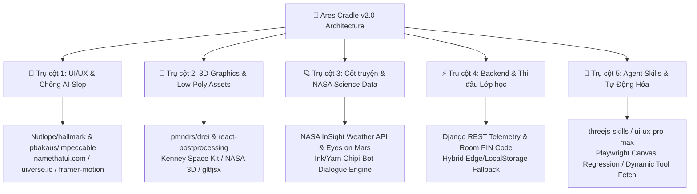

# Technical Architecture Document (v2.0 - Survival Action & Kid-First Restructure)
## Ares Cradle: Extraterrestrial Outpost Simulator & Explorer

**Target Version:** 2.0 (Endless Survival & Low-Poly Action Release)  
**Target Audience:** Elementary & Middle School Students (Ages 7–12), Young Explorers, STEM Competitions  
**Deployment Platform:** Vercel Static Web Hosting (Zero-friction browser play)  
**Core Aesthetic:** Low-Poly Minecraft / Mars Survivor style, Vibrant Cartoon Colors, Tactile & Juicy Feedback  
**Tech Stack:** React 18, Three.js / React Three Fiber, @react-three/drei, Framer Motion, Tailwind CSS, Zustand, Web Audio API

---

### 1. Architectural Philosophy & Core Loop

Ares Cradle v2.0 transforms from an academic telemetry dashboard into an **immersive, low-poly 3D survival adventure** designed specifically for children aged 7–12. The player directly controls a Chibi Low-Poly Astronaut exploring the red planet, gathering resources, defending against escalating dust storms, and upgrading their cozy Martian base.

```mermaid
flowchart TD
    subgraph Exterior_Exploration [Bên Ngoài Bão Cát (Exterior 3D)]
        Player[🧑‍🚀 Astronaut Player - WASD / Joystick] -->|Di chuyển & Khám phá| Surface[Bề mặt Sao Hỏa Low-Poly]
        Surface -->|Nhặt tài nguyên| Crystals[⚡ Tinh thể Năng lượng / 🔩 Mảnh Hợp kim]
        Surface -->|Gặp sự cố| Storm[🌪️ Bão Bụi dồn dập / 🫧 Tụt Bong bóng Oxy]
        Player -->|Tương tác cự ly| SolarFix[🧹 Quét Bụi Pin Mặt Trời [Phím E]]
    end

    subgraph Airlock_Transition [Cửa Khí Airlock Trôi Mượt]
        Player -->|Bước qua cửa trạm| Airlock[🚪 Cửa Airlock Xì Hơi Pssshh]
    end

    subgraph Interior_Sanctuary [Bên Trong Trạm Vòm (Interior Sanctuary)]
        Airlock --> DomeInterior[🏠 Không gian Nhà Vòm An Toàn]
        DomeInterior --> Restore[❤️ Hồi Tim Máu & 🫧 Đầy Bình Oxy]
        DomeInterior --> ObservationDeck[🔭 Cửa Kính Vòm: Ngắm Bão Cát & Vũ Trụ Sao Trời]
        DomeInterior --> StationConsole[🖥️ Bảng Điều Khiển: Nâng Cấp Trạm Rộng Hơn & Đẹp Hơn]
    end

    subgraph HUD_and_Inventory [Hệ Thống HUD & Balo Minecraft]
        ScreenHUD[Màn hình tối giản: Tim ❤️ + Bong bóng Oxy 🫧]
        ScreenHUD -->|Bấm [E] hoặc Chạm Balo 🎒| Backpack[🎒 Balo Thu-Mở: Xem Chỉ Số & Dùng Vật Phẩm]
    end

    subgraph Audio_Juice [Hệ Thống Âm Thanh Subway Surfers]
        Audio[Web Audio Arcade SFX: Ting-ting nhặt đồ, Póc-póc bước chân + Lo-fi Chiptune BGM]
    end
```

---

### 2. Module Directory Structure (v2.0)

```
ares-cradle/
├── public/
│   ├── audio/                 # Nhạc nền Lo-fi Chiptune không gian (space-loop.mp3)
│   └── assets/textures/       # Particle sprites, skybox stars, crosshairs
├── src/
│   ├── modules/
│   │   ├── character/         # Bộ điều khiển nhân vật & Camera
│   │   │   ├── AstronautPlayer.tsx       # Model phi hành gia Low-poly + di chuyển WASD
│   │   │   ├── VirtualJoystick.tsx       # Cần điều khiển cảm ứng cho iPad/Tablet/Mobile
│   │   │   ├── ProximityDetector.tsx     # Nhận diện vùng tương tác (Pin, Cửa trạm, Đá)
│   │   │   └── CameraRig.tsx             # Camera Follow Isometric 45° mượt mà (lerp)
│   │   ├── outpost-3d/        # Không gian 3D Ngoài trời & Trong trạm
│   │   │   ├── MarsCanvas.tsx            # R3F Canvas root & chuyển đổi Exterior/Interior
│   │   │   ├── MarsTerrain.tsx           # Bề mặt địa hình Sao Hỏa, miệng núi lửa Low-poly
│   │   │   ├── HabitatDome.tsx           # Nhà vòm kính: Cửa Airlock đóng/mở tự động
│   │   │   ├── HabitatInterior.tsx       # Nội thất trạm: Cửa kính ngắm sao, cây xanh, bảng máy
│   │   │   ├── SolarArray.tsx            # Trạm pin mặt trời có hiệu ứng bám bụi
│   │   │   ├── ResourceDrops.tsx         # Tinh thể năng lượng rơi trên cát để nhặt
│   │   │   ├── DustStormParticles.tsx    # Bão cát cuộn xoáy Low-poly & gió rít
│   │   │   └── SpaceSkybox.tsx           # Bầu trời đêm vũ trụ lấp lánh sao & mặt trăng Phobos
│   │   ├── survival-ui/       # Giao diện sinh tồn tối giản kiểu Minecraft
│   │   │   ├── MinimalHUD.tsx            # Tim máu ❤️, Bong bóng Oxy 🫧, Nút Balo 🎒
│   │   │   ├── BackpackModal.tsx         # Bảng Balo thu-mở (Phím E, slow-mo 0.2x, lưới slots)
│   │   │   ├── StationControlModal.tsx   # Bảng điều khiển cảm ứng trong trạm & nâng cấp base
│   │   │   ├── AstroBotCompanion.tsx     # Robot trợ lý Chibi (bong bóng thoại hài hước < 10 từ)
│   │   │   └── RewardCelebration.tsx     # Pháo hoa chúc mừng 3 sao ⭐⭐⭐ & Mở Rương Quà
│   │   ├── simulation-engine/ # Engine sinh tồn vô tận & Cân bằng tài nguyên
│   │   │   ├── endlessDirector.ts        # Quản lý nhịp bão, độ khó tăng dần, chu kỳ Ngày/Đêm
│   │   │   ├── formulas.ts               # Tính toán suy giảm Oxy, Thân nhiệt, Tích điện
│   │   │   └── upgradeTree.ts            # Cây nâng cấp trạm (Mở rộng vòm, tăng pin, đèn LED)
│   │   ├── audio/             # Hệ thống âm thanh vui nhộn (Subway Surfers Style)
│   │   │   ├── soundEngine.ts            # Web Audio Synth: ting-ting, whoosh, psshh, cheer
│   │   │   └── musicPlayer.ts            # Trình phát nhạc nền vui nhộn Lo-fi không gian
│   │   └── store/             # Reactive Zustand State
│   │       ├── useOutpostStore.ts        # Toàn bộ trạng thái nhân vật, vị trí, tài nguyên, nâng cấp
│   │       └── storeTypes.ts             # Type definitions
│   └── services/api/          # Service adapter layer (Mock/Django REST)
```

---

### 3. Detailed Component Architecture

#### 3.1. Character & Camera Controller (`character/`)
- **Model phi hành gia:** Ghép từ các khối `boxGeometry` và `cylinderGeometry` phong cách Minecraft, sử dụng `meshStandardMaterial({ flatShading: true })`.
- **Hệ thống điều khiển:**
  - Hỗ trợ phím cứng `W, A, S, D` và 4 phím Mũi tên.
  - Tích hợp `VirtualJoystick.tsx` trên màn hình chạm dành cho học sinh dùng Chromebook cảm ứng / máy tính bảng.
  - Góc xoay nhân vật tính bằng `Math.atan2(moveX, moveZ)` tự quay mặt về hướng di chuyển.
- **Camera Follow (`CameraRig.tsx`):**
  - Chế độ **Exterior:** Camera đặt ở độ cao `Y = 7`, lùi `Z = 9` (góc nhìn 45° Isometric). Dùng `Vector3.lerp(target, 0.1)` tạo cảm giác chuyển động mượt, không giật lag.
  - Chế độ **Interior:** Khi bước qua cửa trạm, camera trôi mượt vào tầm mắt góc nhìn rộng từ trong trạm nhìn ra ngoài qua vách kính toàn cảnh.

#### 3.2. Chuyển Đổi Liền Mạch Hai Không Gian: Ngoài Trời vs. Trong Trạm
- **Airlock Trigger:** Bán kính 2.5m quanh cửa trạm vòm.
- **Cơ chế:**
  - Khi nhân vật bước vào cửa: Âm thanh xì hơi `pssshh`, cửa vòm trượt mở, nhân vật bước vào bên trong, trạng thái chuyển sang `isInsideHabitat = true`.
  - Bên trong trạm: Bong bóng Oxy 🫧 và Thân nhiệt 🔥 hồi phục nhanh lên 100%. Bão cát bên ngoài bị cách ly hoàn toàn, chỉ nghe tiếng gió rì rào êm dịu.
  - Cửa sổ kính vòm: Trẻ có thể đứng ngắm bão cát cuồng phong gầm rú bên ngoài một cách an toàn, hoặc ngắm dải ngân hà lấp lánh sao khi đêm về.

#### 3.3. Bảng Balo Thu-Mở & HUD Tối Giản (Minecraft Inventory Pattern)
- **Minimal HUD (Always visible, non-intrusive):**
  - **Tim máu (Health):** 5 trái tim đỏ ❤️. Mất máu khi hết oxy hoặc quá lạnh.
  - **Bong bóng Oxy (Oxygen):** 5 bong bóng tròn 🫧 nhấp nháy vỡ dần khi ở ngoài bão.
  - **Nút Balo [E]:** Nằm góc dưới màn hình.
- **Backpack Modal (Thu-Mở bằng [E] hoặc click icon 🎒):**
  - Khi mở: Kích hoạt `timeDilation = 0.2` (thời gian chậm lại 5 lần) giúp trẻ em không bị cuống.
  - **Mục Trạng Thái:** Xem chi tiết lượng Oxy bình khí, Nhiệt độ thân nhiệt, Mức pin trạm.
  - **Lưới Ô Vật Phẩm (Slots):**
    - 🧹 *Chổi Siêu Thanh:* Quét sạch bụi trên pin mặt trời trong chớp mắt.
    - 🩹 *Băng Dính Vũ Trụ:* Vá các vết rò rỉ khí.
    - 🔋 *Pin Dự Phòng:* Hồi ngay 25% điện căn cứ khi bị cạn kiệt.
    - 🍎 *Táo Không Gian:* Hồi đầy máu và oxy tức thì.

#### 3.4. Hệ Thống Âm Thanh Arcade Vui Nhộn (Subway Surfers Style)
- Tạm biệt còi báo động chiến tranh vũ trụ chói tai, thay bằng âm thanh hoạt hình tươi vui:
  - 🪙 **Ting-ting ngũ cung (Pentatonic Arpeggio):** Phát ra mỗi khi nhặt được viên tinh thể năng lượng trên cát.
  - 👟 **Póc-póc (Bouncy Step):** Tiếng bước chân nhảy nhót trên nền cát Sao Hỏa.
  - 🧹 **Xoẹt-xoẹt (Whoosh):** Tiếng chùi sạch bụi pin mặt trời.
  - 💨 **Pssshh (Pneumatic Hiss):** Tiếng cửa trạm Airlock đóng mở nén khí.
  - 🎉 **Fanfare Cheer:** Nốt nhạc kèn đồng mừng rỡ khi mở rương quà hoặc nâng cấp trạm thành công.
  - 🎵 **Lo-fi / Chiptune BGM:** Giai điệu nhẹ nhàng, vui tươi, lặp vô tận.

#### 3.5. Hệ Thống Sinh Tồn Vô Tận & Nâng Cấp Căn Cứ (Endless Progression)
- **Vòng lặp sinh tồn:** Càng qua nhiều ngày Sol, bão cát càng xuất hiện thường xuyên hơn và tinh thể rơi nhiều hơn.
- **Thu thập tài nguyên:**
  - ⚡ *Tinh thể Điện (Power Shard):* Dơi dù từ trên trời hoặc đào từ mỏ đá.
  - 🔩 *Mảnh Hợp Kim (Alloy Scraps):* Rơi từ thiên thạch.
- **Bảng Nâng Cấp Trạm (Station Upgrades):**
  - *Cấp 1 -> Cấp 2:* Mở rộng vòm kính rộng gấp đôi, lắp thêm dàn đèn LED 7 màu.
  - *Cấp 2 -> Cấp 3:* Xây thêm Module Vườn Sinh Thái (Bio-Garden) trồng dưa hấu và táo Sao Hỏa.
  - *Cấp 3 -> Cấp 4:* Thêm sân đỗ xe Rover mini và tháp phát điện gió vũ trụ.

---

### 4. Technical Guarantees & Constraints
- **Performance:** 60 FPS mượt mà trên laptop học sinh và Chromebook nhờ phong cách Low-Poly không dùng texture nặng.
- **Zero-Dependency Sound:** Bộ synthesizer Web Audio tích hợp sẵn trong code, không phụ thuộc kết nối mạng tải file âm thanh lớn.
- **Responsiveness:** Tương thích 100% chuột/bàn phím PC và màn hình cảm ứng điện thoại/tablet qua Joystick ảo.

---

### 5. Hệ Thống Công Cụ & Thư Viện Cải Tiến Mở Rộng (Ecosystem, Tooling & Enhancements)

Nhằm tối ưu hóa toàn diện cho game Ares Cradle (v2.0) đạt chuẩn chất lượng quốc tế của NASA Space Apps Challenge, hệ thống áp dụng bộ 5 trụ cột công cụ, repo và kỹ năng sau:



#### 5.1. Trụ Cột 1: UI/UX, Tactile Micro-Interactions & Kiểm Định Chống AI Slop
- **Nutlope/hallmark ([GitHub](https://github.com/nutlope/hallmark)):** Kiểm định thiết kế, bắt buộc sử dụng CSS variables/design tokens cho toàn bộ hệ thống màu sắc (`#C1440E` Mars rust, `#00F0FF` Cyan visor, `#FFB020` Amber hazard). Cấm triệt để AI tropes (`transition: all`, card grid lặp lại, gradient tím-xanh rập khuôn).
- **pbakaus/impeccable ([GitHub](https://github.com/pbakaus/impeccable)):** Chuẩn hóa vòng đời thiết kế UI, thẩm định visual hierarchy, typography scaling và trạng thái tương tác hoàn chỉnh (hover, active, focus-visible, disabled, loading skeletons) cho từng nút bấm, slot balo và bảng nâng cấp.
- **Namethatui ([namethatui.com](https://namethatui.com)):** Thư viện chuẩn hóa thuật ngữ và pattern UI hiện đại (Floating Action Decks, Collapsible Drawers, Bento Cards).
- **Uiverse ([uiverse.io](https://uiverse.io)) & 21st.dev ([21st.dev](https://21st.dev)):** Bộ sưu tập linh kiện vi tương tác (micro-interactions) bằng Tailwind/CSS thuần: switch bật nén khí, slider điều áp pin, icon button có độ nảy xúc giác.
- **Framer Motion ([framer-motion](https://motion.dev)) & Canvas Confetti:** Chuyển động vật lý lò xo (spring physics) khi bung mở Balo Minecraft và hiệu ứng nổ pháo hoa mừng hoàn thành Sol.

#### 5.2. Trụ Cột 2: Đồ Họa 3D, Low-Poly Assets & Công Nghệ Three.js/R3F
- **Kenney Space Kit ([kenney.nl/assets/space-kit](https://kenney.nl/assets/space-kit)):** Kho tài nguyên 3D Low-Poly chuẩn bản quyền CC0 (Public Domain): phi hành gia chibi, mô đun nhà vòm, trạm pin, xe rover, đá thiên thạch và tinh thể năng lượng.
- **pmndrs/gltfjsx ([GitHub](https://github.com/pmndrs/gltfjsx)):** CLI tự động phân tích và chuyển đổi file mô hình 3D `.glb`/`.gltf` thành component React Three Fiber có gắn sẵn type TypeScript và hook điều khiển.
- **NASA 3D Resources ([nasa3d.arc.nasa.gov](https://nasa3d.arc.nasa.gov) / [nasa/NASA-3D-Resources](https://github.com/nasa/NASA-3D-Resources)):** Kho mô hình 3D nguyên gốc từ NASA (Perseverance rover, Ingenuity helicopter, InSight lander, Artemis suits) dùng làm hologram lưu trữ và huy hiệu trong game.
- **pmndrs/drei ([GitHub](https://github.com/pmndrs/drei)):** Tiện ích R3F hàng đầu: `Html` (nhúng UI vào không gian 3D), `Billboard` (tinh thể luôn hướng về camera), `Sparkles` (bụi sao ban đêm), `Float` (đá nổi), `KeyboardControls`.
- **pmndrs/react-postprocessing ([GitHub](https://github.com/pmndrs/react-postprocessing)):** Pipeline xử lý hậu kỳ GPU: Bloom cho tinh thể phát sáng, Noise/Grain và Vignette đỏ cam tạo cảm giác bão cát rát mặt, Chromatic Aberration khi căn cứ sụt nguồn.
- **pmndrs/leva ([GitHub](https://github.com/pmndrs/leva)):** Bảng điều khiển tham số thời gian thực (GUI) giúp nhà phát triển căn chỉnh ánh sáng, độ dày bão bụi và góc quay camera trực tiếp trên trình duyệt.

#### 5.3. Trụ Cột 3: Cốt Truyện, Khoa Học & Dữ Liệu Thực Tế NASA (Space Apps Challenge)
- **NASA InSight Mars Weather Service API ([api.nasa.gov](https://api.nasa.gov)):** Lấy dữ liệu thời tiết thực tế từ vùng lòng chảo Elysium Planitia trên Sao Hỏa (nhiệt độ dao động từ -95°C đến -5°C, áp suất khí quyển, vận tốc gió giật) để điều phối độ khó của bão cát trong game.
- **NASA Eyes on Mars ([eyes.nasa.gov](https://eyes.nasa.gov)):** Tham chiếu địa hình thực (miệng núi lửa Jezero, thung lũng Valles Marineris) và quỹ đạo của vệ tinh Phobos/Deimos trên bầu trời đêm.
- **Narrative Engine cho Chipi-Bot (JSON / Ink Pattern):** Hệ thống cây thoại phân nhánh ngắn gọn (< 10 từ/câu) với tính cách tinh nghịch, vừa hướng dẫn vừa giải thích nguyên lý sinh tồn thực tế của NASA (hệ thống tái tạo oxy Sabatier, máy sưởi đồng vị phóng xạ RTG, nhà kính khí canh Aeroponics).

#### 5.4. Trụ Cột 4: Backend, Đồng Bộ Thi Đấu Lớp Học & Telemetry Analytics
- **Django REST Framework (`backend/`):**
  - **Classroom Room PIN & Live Session:** Giáo viên tạo phòng với mã PIN 6 số; học sinh trong lớp nhập PIN để tham gia phiên thi đấu sinh tồn thời gian thực.
  - **Telemetry Logging (`apps/telemetry/`):** Ghi nhận chi tiết các quyết định phân bổ điện, thời gian phản ứng khi bão tới, số lần quét pin mặt trời phục vụ báo cáo đánh giá tư duy kỹ thuật của học sinh.
  - **Leaderboard API:** Bảng xếp hạng Sol cao nhất, số tinh thể thu thập và huân chương đạt được.
- **Hybrid Resilience Fallback:** Nếu game chạy ở chế độ static (Vercel) không kết nối được server Django cục bộ, game tự động chuyển mượt sang LocalStorage / Vercel Edge Serverless mà không xuất hiện lỗi màn hình.

#### 5.5. Trụ Cột 5: Agent Skills, Kiểm Thử Tự Động & Quy Tắc Mở Rộng
- **Thư viện Agent Skills tích hợp:**
  - `threejs-skills`: 13 cẩm nang chi tiết về WebGPU, shader, asset pipeline, R3F và tối ưu hóa hiệu năng canvas.
  - `ui-ux-pro-max`: Bộ tiêu chuẩn 79 style và 119 quy tắc UX.
  - `karpathy-guidelines` & `ponytail`: Giữ mã nguồn tối giản, diff phẫu thuật, không sinh code thừa.
- **Playwright / Puppeteer Canvas Testing:** Chụp ảnh tự động canvas WebGL định kỳ sau các commit để phát hiện sớm các lỗi tụt FPS, vỡ texture hoặc lệch tọa độ camera.
- **Quy Tắc Mở Rộng Động (Dynamic Tool Adoption Invariant):** Antigravity và các agent phối hợp được phép chủ động tìm kiếm, tải về (`curl`/`git`) và tích hợp thêm bất kỳ thư viện hoặc công cụ mã nguồn mở nào khác trên GitHub nếu phát hiện phương án tối ưu hơn giải pháp hiện tại.
