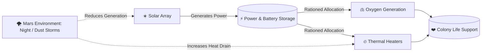

# Product Requirements Document (PRD)
## Ares Cradle: Extraterrestrial Outpost Simulator (Demo)

**Target Release:** Demo v1.0  
**Target Audience:** Elementary & Middle School Students (Ages 7–12), Educators, STEM Competitions  
**Deployment Target:** Vercel Static Web Application (Zero friction, instant browser play)  
**Aesthetic Standard:** Hallmark & Impeccable (Refined visual hierarchy, tactile UI, anti-slop craft)

---

### 1. Executive Summary & Problem Statement

#### 1.1 The Educational Problem
Educational space STEM games frequently fail in one of two directions:
1. **Oversimplified Clickers:** Shallow mechanics with no genuine technical consequences (e.g., clicking a button produces infinite energy).
2. **Dense Academic Simulators:** Overwhelming spreadsheets and multi-variable differential equations that alienate young learners.

#### 1.2 The Solution: "Ares Cradle"
A tactile, browser-based Mars outpost simulator where young players take command of a fledgling Martian colony. The game simplifies operations to **two interconnected core systems** (Energy vs. Life Support) while preserving authentic engineering trade-offs: *every decision has an immediate physical cost.*

---

### 2. Core Player Experience & Persona

- **Primary Persona:** "Cadet Leo" (Age 9–11). Curious, visual learner, motivated by instant visual feedback and clear cause-and-effect.
- **Secondary Persona:** STEM Teacher running a 15-minute classroom demonstration without student accounts or setup friction.
- **Player Journey:**
  1. **Instant Launch (< 5 seconds):** Loads directly in browser on Chromebook/laptop/tablet without login.
  2. **Tactile Orientation (< 30 seconds):** Interactive 3D Mars diorama shows Solar Panels, Battery Bank, and Habitat Dome.
  3. **Stage Challenges:** 3 progressive bite-sized missions testing power rationing during Mars environmental crises.
  4. **Debriefing & Mastery:** Clear engineering summary explaining *why* their trade-off succeeded or failed.

---

### 3. Core Gameplay Mechanics: The 2-Resource Trade-off

To avoid cognitive overload for ages 7–12, tracking systems are focused strictly on two interdependent survival pillars:

#### 3.1 Primary Resource 1: Energy (Power & Battery Reserve)
- **Generation:** Photovoltaic solar array output depends on sunlight intensity.
- **Storage:** Battery Bank stores surplus daytime kWh.
- **Depletion:** Power drains constantly to run base systems. Zero battery at night triggers emergency brownout.

#### 3.2 Primary Resource 2: Life Support (Oxygen & Thermal Heat)
- **Atmosphere (O₂):** Sabatier / Electrolysis systems require continuous power to keep oxygen above 19.5%.
- **Thermal Equilibrium (°C):** Mars ambient temperature drops to -60°C. Heaters keep the habitat at +20°C.
- **Consequence:** Cutting heater power saves energy for oxygen, but habitat temperature plummets, causing crew distress.

#### 3.3 Interactive Control Actions (Tactile Toggles & Sliders)
1. **Power Router (Slider / Stepper):** Divert energy priority between Life Support (Oxygen) and Thermal Heaters (Comfort).
2. **Dust Wiper (Clickable 3D Solar Array):** Tap or drag to brush off Martian dust during storms to restore solar intake.
3. **Emergency Power Saver (Toggle):** Dim non-essential base lighting to preserve 15% battery during crises.

---

### 4. Mission Stage Progression (5 Sol Milestones & 4-Phase Sortie)

The simulation enforces the **4-Phase Sortie Loop** (Briefing -> Checkpoint Sortie -> High-Tension Return to Base -> Lab Analysis & Upgrade) across 5 real-time Sol milestones within an 80m exploration sphere:

| Sol | Title & Checkpoint | Distance & Mode | NASA Mission Feature | Core Engineering Trade-off |
|---|---|---|---|---|
| **Sol 1** | *First Light: Solar Array* | `8.0m` (Foot EVA) | **Opportunity** (Solar Arrays & RAT Tool) | Daylight generation vs night freeze; clean dust deposits and balance 50/50 battery allocation. |
| **Sol 5** | *Red Wall: Crater Alpha* | `35.0m` (Rover Recommended) | **Spirit & Opportunity** (Hematite Blueberries) | Electrostatic dust devil reduces visibility by 60%; harvest samples and race back before storm landfall. |
| **Sol 9** | *Frozen Water: North Glacier* | `55.0m` (Rover Required) | **Phoenix Lander** (Permafrost Ice Trench) | Extreme polar cold (-80°C); suit heating drain spikes; drill ice core and return to purify water in lab. |
| **Sol 12** | *Breath of Mars: MOXIE Tower* | `40.0m` (Foot / Rover) | **Perseverance** (MOXIE CO2-to-O2 Electrolysis) | Hull seal Bravo breach causing pressure drop; retrieve catalyst and pressurize O2 chamber. |
| **Sol 20** | *Green Shield: Mesa Peak* | `75.0m` (Rover High-Beam) | **Curiosity RAD & ISS Veggie** (Ares-1 Touchdown) | High-range navigation over rough terrain; activate sky laser landing beacon to guide crewed fleet. |

---

### 5. UI/UX & Aesthetic Requirements (Hallmark & Impeccable)

#### 5.1 Hallmark Design Philosophy
- **Anti-Slop Visuals:** No generic AI template styling, no bloated card grids, no empty decorative badges.
- **Authentic Space Craft:** Muted Martian rust (`#C1440E`), deep space charcoal (`#0B0E14`), tactile luminescent cyan (`#00F0FF`) and safety amber (`#FFB020`).
- **Physicality & Micro-Interactions:** Buttons depress with physical weight; switches toggle with crisp spring physics via Framer Motion; dials show smooth inertia.

#### 5.2 Interface Architecture (Interactive 3D Diorama + Floating HUD)
- **Center Canvas:** 3D Three.js Mars Outpost (interactive orbit controls, zoom to modules, dust storm particle effects, planet radius calibrated to 80m).
- **Top Bar:** Sol counter, mission timer, current stage objective, and circular Mini-Radar showing base camp and active POIs.
- **Floating Bottom HUD / Horizontal Datapad:**
  - **Minimalist Horizontal Telemetry Bar:** Power, Battery, Oxygen, and Habitat Temperature.
  - **Interactive Pop-up Cards:** Clicking any metric card opens a focused educational panel directly above the bar explaining the current reading and its engineering significance.
  - **Zero Overlap:** Top Visor and Bottom Datapad remain strictly non-overlapping.

#### 5.3 Language, Layout & Essential-Only Constraints
- **100% English Standard:** All in-game text, tooltips, dialogues, and science logs are strictly English (no mixed languages).
- **Essential-Only & Anti-Clutter:** Only elements with an active functional or educational role are shown. Concise wording (< 15 words for alerts).
- **80m World Radius:** Planetary bounds scaled to 80m so students can navigate and return to base smoothly.
- **Audio Feedback:** Sub-bass hum for base power, crisp mechanical switch clicks, telemetry notification chimes, alarm sirens for emergency levels.

---

### 6. Technical & Delivery Constraints

1. **Deployment:** Hosted statically on GitHub, deployed instantly via Vercel (`vercel.app`).
2. **Performance:** Smooth 60 FPS Three.js rendering on standard Intel UHD/Chromebook graphics. First Contentful Paint < 1.2s.
3. **Zero Auth / Zero Barrier:** No login, no telemetry tracking, instant play in modern Chrome, Edge, Safari, Firefox.
4. **Architectural Modularity:** Decoupled simulation logic and service layer to enable drop-in Django backend migration in Phase 2.

---

### 7. Success Criteria

- [ ] Interactive 3D scene renders smoothly in browser with clickable solar panels and habitat.
- [ ] 3 playable stages with distinct win/loss states based on real energy/life support trade-offs.
- [ ] Hallmark-grade UI with zero visual glitches, readable typography, and tactile spring feedback.
- [ ] 100% automated Vercel CI/CD deployment passing all static build checks.
